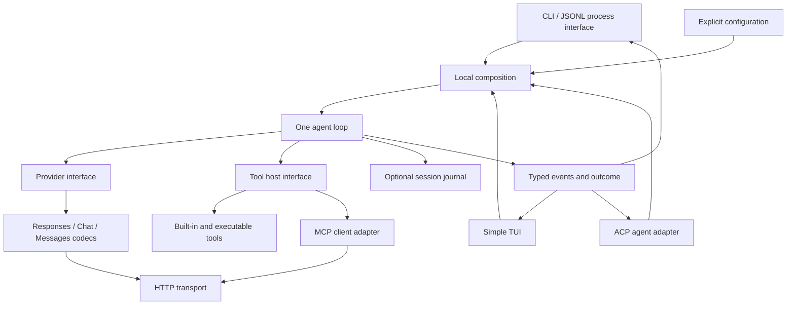

# foo architecture

Status: proposed v1 architecture, 2026-11-16. The F00 bootstrap supplies shared contracts and test adapters. The runtime described here is not implemented or qualified. See [the shared contracts](../src/contracts/README.md) for the current API.

foo is a small Zig library and executable for running one configurable agent conversation. Its job is to send a request to a model, stream the response, execute declared tools, append their results, and repeat until the model finishes or the caller stops it. CLI, a simple TUI, an MCP client, and an ACP agent use that same implementation.

This document is the canonical design narrative, including provider and process-interface semantics. [Evidence](plan/evidence.md) explains the reference analysis. [Protocols](protocols.md) defines MCP and ACP contracts. [Execution](plan/execution.md) assigns independent implementation packages and integration order. [Testing](testing.md) defines qualification and performance measurement. MCP/ACP revisions and capability tables belong in the protocol document.

## Product contract

The first release supports Linux, macOS, and Windows natively. It supports the OpenAI Responses, OpenAI Chat Completions, and Anthropic Messages API families, including xAI through the appropriate compatible family. Configurable endpoints are part of the product, with explicit compatibility limits. MCP client support and ACP agent support are first-release requirements.

The priorities are predictable behavior, low local overhead, bounded resource use, minimal dependencies, and explicit configuration. Correct streaming, cancellation, tool outcomes, and resumable history are baseline requirements. A smaller executable that corrupts tool arguments or leaves commands running is not a successful simplification.

“Unopinionated” means that foo does not choose the user's workflow. The neutral library supplies no system prompt, coding instructions, tools, model selection, provider fallback, goal logic, or autonomous continuation policy. The executable requires an explicit configured model. A named optional coding preset supplies useful tools and a visible, replaceable prompt. Transport validation, resource bounds, deterministic ordering, and truthful outcomes remain defined behavior; they are necessary contracts rather than workflow policy.

The first release does not contain subagents, goals, a planner, worktree management, a task scheduler, an audit model, automatic verification, automatic commits, a daemon, an HTTP server for local UI, an extension package manager, embedded JavaScript/WASM, a browser UI, a desktop framework, enterprise configuration management, or a sandbox implementation. An outer project may launch several foo processes and own these features. Their absence is an intentional product limit, not a backlog for this repository.

## System shape

[ADR 0001](adr/0001-external-orchestration.md) records why orchestration stays outside foo.

The target executable permits one active run per process, including ACP mode. A process may hold bounded idle-session metadata and remain open for several sequential prompts. Each library instance owns one active run; an embedding application may create independent instances and owns any coordination between them. foo supplies no scheduler. Multiple ACP session identifiers do not enable concurrent active prompts.

Local CLI and TUI operation calls the library directly. JSONL process input/output is the stable integration mechanism for external orchestration. ACP is an editor-facing protocol adapter. MCP supplies tools from external servers. Neither protocol changes who owns the agent loop.

## Module ownership

Use one Zig package and one executable. Directories organize ownership; they do not imply separately published packages or a dynamic plugin system. Each implementation package owns its focused tests under the corresponding owner directory described in [Execution](plan/execution.md).

| Owner | Paths | Owns | Must not own |
| --- | --- | --- | --- |
| F00 | `src/contracts/**` | Shared messages, events, outcomes, limits, cancellation and interface contracts | Concrete transport, UI, providers, tools |
| F01 | `src/transport/**` | HTTP connections, request deadlines, certificates, proxies, cancellation | Provider request grammar or agent retries |
| F02 | `src/wire/**` | Bounded incremental framing and JSON/SSE/JSON-RPC primitives | MCP or ACP lifecycle policy |
| F03 | `src/core/**` | One run, ordered tool loop, limits, outcome, request preparation seam | Concrete providers, persistence format, protocols, UI |
| F04 | `src/providers/**` | Three provider codecs, capability checks, provider replay data | Tool execution or model-routing policy |
| F05 | `src/tools/**`, `src/platform/process/**` | Built-in and executable tools, output capture, process cleanup | Agents, worktrees, shell-intent classification |
| F06 | `src/mcp/**` | MCP client lifecycle, discovery, tool mapping, calls and cancellation | Agent decisions, MCP server hosting |
| F07 | `src/session/**` | Optional journal, locking, artifacts, recovery and context loading | Automatic tool replay or compaction model |
| F08 | `src/acp/**` | ACP agent lifecycle, capability negotiation, session and event mapping | A second agent loop or editor-independent task scheduler |
| F09 | `src/config/**` | JSON parsing, validation, explicit precedence, redaction | Runtime execution or implicit project discovery |
| F10 | `src/cli/**` | Arguments, text/JSONL output and process input controls | Provider, tool, or loop logic |
| F11 | `src/tui/**`, `src/platform/terminal/**` | Input, transcript viewport, status and terminal lifecycle | Product state or background scheduling |
| F00/F12 integrator | `src/main.zig`, `src/lib.zig`, `build.zig`, `build.zig.zon`, `.github/**` | Public exports, composition, build and release qualification | Leaf implementation logic |

Concrete implementations depend on contracts. Core receives implementations through the declared interfaces; it does not import CLI, TUI, MCP, ACP, configuration parsing, or concrete provider modules. A wire primitive is shared only when framing or parsing actually matches. Do not merge MCP and ACP into a configurable protocol framework merely because both use JSON-RPC.

Freeze the smallest useful contracts in F00 before parallel implementation. Implementers can propose a contract change with one failing fixture and its required call-site changes. They do not widen another owner's interface unilaterally. The integrator owns shared build files and the public facade, avoiding parallel edits to the composition root.

## Core behavior and host control

The conceptual library surface is a run initialized with explicit messages, model settings, tools, limits, an allocator, an I/O context, and host interfaces. Names and exact Zig signatures are finalized in F00 against the pinned compiler; this document specifies semantics rather than claiming compilable code.

The required interfaces are:

| Interface | Caller supplies | Contract |
| --- | --- | --- |
| Provider | Model configuration and a request stream implementation | Ordered typed events, terminal reason, available usage, cancellation |
| Tool host | Tool declarations and execution implementation | One correlated outcome per admitted call; bounded output; explicit effect state |
| Request preparation | An optional context transformation for the next request | Runs at a turn boundary; returns a valid owned or borrowed context view under a documented lifetime |
| Event consumer | An event sink | Separates transient deltas from committed records and terminal outcome |
| Session store | Optional append/commit implementation | Defined commit guarantee; errors cannot be hidden after an effect |
| Cancellation | Run-owned cancellation source | Wakes waits and prevents admission of new effects |

Request preparation is a narrow seam needed for embedding and external context management. It may replace context before a provider request. It cannot silently schedule an extra turn after normal completion, change tool grants during an in-flight batch, or revive a cancelled run. foo supplies no general hook bus, ordered middleware chain, or model-driven final-answer classifier.

The loop is:

1. Validate configuration, initial context and declared tool contracts before starting network or process effects.
2. Prepare the next request from the current context. Check explicit run limits and local resource bounds.
3. Stream provider output. Render deltas provisionally while accumulating one bounded in-progress response.
4. Accept a response only under the provider codec's terminal rules. Never execute partial tool arguments, including syntactically valid JSON salvaged from a truncated response.
5. If the completed response has tool calls, validate and execute them serially in assistant order. Append correlated tool outcomes in that same order, then make the next request.
6. If the completed response has no tool calls, return control to the caller. No hidden “keep going” prompt follows it.

Unknown tools and invalid arguments become bounded, correlated tool errors when the conversation can continue safely. Invalid provider framing, incompatible replay state, fatal persistence errors, or exhausted configured limits terminate with typed outcomes. A malformed call does not acquire authority to run another tool.

Turn completion means the model stopped normally. It does not mean the user's work was independently verified. Preserve terminal distinctions such as `completed`, `cancelled`, `interrupted`, `limit_reached`, `provider_error`, and `storage_error`; attach the provider stop reason and any uncertain effects. A refused request or output-token cutoff must not be silently presented as an ordinary completed answer.

## Runtime, memory and cancellation

One owner mutates a run's transcript, turn number, pending tool batch and terminal outcome. I/O tasks report events to that owner; they do not mutate the transcript. Use the pinned Zig standard I/O facilities and a small number of bounded tasks or workers where blocking platform operations require them. Do not build an async framework, general executor, or actor system.

Memory ownership must be part of the contracts:

- The caller owns the root allocator and I/O context and keeps them alive through run teardown.
- Immutable effective configuration and admitted tool declarations live for the run. No background discovery mutates the request while it is being serialized.
- A request arena owns temporary serialization and decoder scratch. It survives until all I/O using it has ended; cancellation alone is not permission to free it.
- Completed transcript blocks move into session-owned storage or are copied explicitly. No borrowed response-buffer slices escape into history.
- Delta callbacks borrow data only for the callback duration. A queue or asynchronous consumer must take ownership or copy within its byte allowance.
- Cancellation is run-owned and shared through a narrow handle. A command or connection task must finish, transfer ownership explicitly, or remain owned by a longer-lived transport object before its memory can be reclaimed.
- Session history has an explicit working-set bound. A long journal must not force the process to retain every historical token and artifact in memory.

Bound both item counts and bytes for provider frames, tool arguments, tool output, protocol requests, pending events, active commands and transcript memory. The F00 contract fixtures pin initial values; user-facing configuration exposes useful limits, not every internal buffer size. Integer overflow, nested JSON depth and allocation failure are ordinary typed failures.

Keep control responsive under load. A full display queue can coalesce provisional text updates or apply backpressure; it cannot prevent cancellation from reaching the run. A permanently blocked stdout consumer must not leave child processes alive indefinitely. Terminal restoration and process cleanup occur on normal exit, error and interruption.

Cancellation means: stop accepting new tools, interrupt the provider request, request termination of owned commands, reap what the platform allows, and record known outcomes. A cancelled or disconnected remote MCP call can have an uncertain effect; sending a cancellation notification is not proof that the server stopped. No module may turn a cancel request into a successful outcome simply because its local wait ended.

## Provider support

Implement three explicit codecs: OpenAI Responses, OpenAI Chat Completions and Anthropic Messages. OpenAI, Anthropic and xAI named configurations are qualified examples of those families. Base URLs, model identifiers, credential references, headers and declared compatible request options are data. Event grammar, tool-call encoding, terminal reasons, usage mapping and reasoning replay are codec code.

“Compatible provider” means the endpoint passes the documented family conformance fixtures for the advertised capabilities. It does not promise support for every service that labels itself OpenAI-compatible. The release matrix names tested endpoints and fixture profiles. Unknown capabilities fail clearly or remain disabled; foo does not silently pretend an unsupported feature worked.

Provider-specific replay blocks remain opaque tagged data owned by their codec. Store the origin family and other identity needed to reject unsafe reuse. Do not flatten reasoning signatures, encrypted items or native content into generic text. Switching providers must either use a supported context conversion or return an incompatibility result; never replay one provider's opaque state to another by accident.

Preserve text, tool, and required reasoning/replay behavior across all three families. F04 publishes a provider-specific matrix for supported content and request options; baseline model input/output is text and function tools, plus required opaque replay items. Image/audio generation and arbitrary multimodal conversion are outside baseline support. MCP/ACP content follows the capability limits in [Protocols](protocols.md); reject unsupported media without silently dropping it. Do not advertise multimodal features because a type can contain bytes.

Credentials are resolved at the effectful edge from explicit references, initially environment-based references and the protocol-specific mechanisms selected in the protocol plan. Redacted configuration must never print resolved secrets. Arbitrary request fields cannot override fields the codec owns, such as messages, tools, model, stream behavior or output limits. Reject collisions before sending a request.

Retries have one owner and a finite configured allowance. Retry only categories and delivery states that the codec and transport can justify. Never restart a run, repeat tools, or silently switch providers as a consequence of a network error. Once partial output has been exposed, recovery must preserve its identity and visible semantics or return an interrupted outcome; it must not concatenate a fresh response onto the old one invisibly. Authentication failures and unsupported request options return control to the caller.

## Tools and process lifecycle

The neutral core starts with an empty tool catalog. The host can opt into the coding preset for `read`, `write`, `edit`, and `exec`, or explicitly select individual tools. The registry exposes the selected tools with stable names and argument schemas. It can also expose host-configured executable tools.

| Tool | Required behavior |
| --- | --- |
| `read` | Bounded byte ranges with a whole-file SHA-256. Request base64 for binary data. |
| `write` | Create or replace one file with bounded content. Return the size and SHA-256. |
| `edit` | Apply unique, disjoint byte replacements to one file at its expected SHA-256. Reject stale or ambiguous input. |
| `exec` | Run an argument vector in the host-configured working directory and environment. Return bounded output and the exit status. |

The file tools operate on one file per call. An edit validates every replacement against the same snapshot before replacing the file. The result distinguishes a rejected edit from an uncertain replacement.

Custom executable tools receive validated JSON on stdin and return one JSON result on stdout. The host supplies argv, environment policy, schema, and limits. Stderr carries diagnostics. The registry checks the supported JSON Schema subset when it loads a tool and validates arguments before dispatch. [Tool schemas and filesystem limits](../src/tools/README.md).

The native process adapter provides independent stdin, stdout, and stderr. Tool execution drains output under an excerpt limit and can write a bounded spool. The invocation returns after exit or cancellation cleanup, with the available exit status and effect outcome. POSIX process groups and Windows job objects own ordinary descendants. Processes run with the launching account's privileges. A caller that needs containment must supply isolation through its account, container, or VM. [Native process behavior and limits](../src/platform/process/README.md).

### Local Code Mode follow-up

A later opt-in Code Mode can run model-authored code in a local sandbox. The sandbox calls tools through the same enabled registry and follows its permission, cancellation, and resource limits. Local calls work without an MCP server. MCP tools can use the same interface once the host exposes them through the registry.

## MCP and ACP

MCP is a client-side tool and context adapter. It owns discovery under the negotiated protocol profile, schemas, tool-name mapping, resource/template/prompt access, server connection lifetime, invocation, result conversion and cancellation. It returns the same tool outcomes as built-ins. Tool declarations admitted for a run remain stable for that run. A detected removal, schema change, or revocation prevents affected calls with `catalog_changed`; additions and replacement schemas become visible on the next run. Remote effects are subject to the same uncertain-outcome rules as local executable tools.

ACP is an agent adapter for editors and other ACP clients. It maps supported lifecycle requests, session prompts, cancellation, permissions and streamed updates onto the same host and run contracts. It does not generate its own hidden system prompt or tool policy. Client-provided capabilities and configured permissions determine what is available; advertised unsupported capabilities must remain false or absent as the protocol requires.

The MCP/ACP owner pins protocol versions and implements only the profiles listed in [Protocols](protocols.md). Current MCP profiles differ in lifecycle and discovery, so do not hardcode a universal initialization sequence in shared core or wire code. ACP draft features are not silently included in a stable capability claim. Authentication, resource blocks, transport variants and native acceptance cases are specified in that document.

## Configuration

Use JSON to avoid another parser dependency and to support machine-generated configuration. Reject unknown keys, duplicate keys where observable, unsupported versions, invalid combinations and excessive nesting/size. Error messages include the setting path and source.

The precedence is explicit and short: built-in mechanical defaults, an explicitly chosen preset, the user's explicit configuration file(s) in command order, declared environment overrides, then CLI overrides. No recursive walk for project configuration, no managed/MDM layer, no remote organization document, and no implicit execution of config helpers. Loading a repository's file requires an explicit file argument or a user-owned configuration reference.

Object fields merge only under documented rules. Lists of tools and prompt fragments replace rather than secretly concatenate; deletion/disable has an explicit representation. `config check` validates without starting providers, MCP servers or tools. `config show` displays the effective configuration with secrets redacted and source attribution for overridden values.

The schema covers provider endpoints/family/model/credential references, model options, prompt replacement or explicitly ordered prompt files, tools and MCP servers, execution environment, run/resource limits, optional session persistence, and basic UI settings. The model identifier is data, not an enum that requires a release for every new model. Unsupported effort/sampling fields are not guessed from model-name substrings.

System prompt replacement means replacement, including an empty prompt. Appended prompt files are opt-in and shown in effective configuration. Automatic `AGENTS.md` loading, skill discovery and coding instructions do not occur in neutral mode. The coding preset may offer explicit instruction-file inclusion, but the user can inspect and disable it.

## Sessions, journals and effect uncertainty

[ADR 0002](adr/0002-journal-effect-uncertainty.md) records the effect-boundary and uncertainty decision.

Persistence is optional. With persistence disabled, foo keeps only the bounded in-memory context and configured output artifacts for the current run. With persistence enabled, use a linear append-only JSONL journal plus bounded artifact files. Do not import QQ's database schema or PI's tree/branch navigation model.

Journal records are semantic: session header/version, configuration identity without secrets, input messages, completed assistant messages including necessary provider replay state, tool dispatch intent, tool result/effect state, and terminal outcome. Token deltas are not individually durable. Keep transient display events separate from committed-record events.

Each session has one writer lock, monotonically ordered record identifiers, a format version and a bounded record size. Artifact references are session-relative, validated and owned by the session store; they cannot escape through path traversal. A streaming loader bounds memory, distinguishes a torn final record from corruption in the middle, and refuses silent history loss. Maintenance never deletes artifacts belonging to an active session.

The first persisted implementation provides a single documented commit mode: synchronize the journal at semantic effect boundaries and before reporting committed outcomes. Synchronize newly created session metadata as required by each platform's filesystem behavior. Qualify process-crash recovery natively; do not claim immunity to arbitrary filesystem or hardware failures. Performance measurement includes the actual synchronization policy.

The effect sequence is:

1. Commit the completed assistant request and the intended tool call before dispatch.
2. Execute the effect once within the active process.
3. Commit its observed outcome and necessary artifact metadata. When the outcome references a durable artifact, synchronize that artifact before committing the reference.
4. Publish a committed result and allow the next dependent effect.

There is an unavoidable window between effect execution and outcome commit. A crash in that window leaves the effect uncertain. A recorded dispatch intent with no result does not prove whether the effect occurred. Recovery reports the uncertainty and never automatically replays the tool. If outcome commit fails after execution, terminate further effects and surface the uncertain durable outcome to the caller.

Persistence also cannot make a remote model request exactly once. A disconnected request may have consumed provider tokens without returning usage. Represent usage as unknown when it is unknown. Do not label missing usage as zero.

Resuming loads a valid completed context prefix and the interrupted-state report. The caller explicitly supplies the next prompt or reconciled context. foo does not invent a recovery goal or automatically continue side effects. Session format migrations are explicit and narrow; a new unsupported format produces an error rather than a best-effort destructive rewrite.

## Context policy

The initial release does not run an automatic compaction model, prune history silently, or continue after a normal answer. Known context limits and configured output reserves are checked before requests where possible. Provider-reported exhaustion is a typed outcome. Byte limits protect local memory; byte counts are not represented as exact model tokens.

The caller can inspect/export retained messages and construct a replacement context through the request-preparation interface or a subsequent invocation. Original history remains available in the journal when enabled. If a host supplies summarization, it owns the model call, cost, instruction preservation and acceptance criteria. It does not require changes to foo's loop.

## CLI and simple TUI

The proposed command families are `foo run`, `foo tui`, `foo rpc`, `foo acp`, and `foo config check/show`, plus ordinary help/version. F10 finalizes exact flags against the shared contracts. Plain prompt stdin and JSONL control stdin are separate explicit modes. There is no local server command.

Text mode writes useful response text to stdout and diagnostics to stderr. JSONL mode writes only versioned protocol records to stdout, with request/run correlation and a terminal outcome. Unknown input commands receive a structured error. Credentials, terminal control codes and debugging chatter must not contaminate machine output.

The initial control interface accepts a prompt when idle and cancellation while running. A second prompt while busy returns `busy`; it is not queued or turned into steering. EOF and broken-pipe behavior are documented and tested. Sequential sessions remain the host's explicit choice. Tool permission requests, when configured and supported by the frontend, follow the protocol document; a headless mode never waits for an unavailable human indefinitely.

The TUI has a transcript viewport, a multiline input editor, tool progress, and a compact status line. It supports resize, scrolling, paste, cancellation and reliable terminal restoration. Use one state projection over core events; the TUI must not assemble a different model transcript. Render only changes and coalesce rapid deltas while preserving input responsiveness. Provide plain output when terminal capabilities are insufficient.

Syntax highlighting grammars, images in terminal cells, mouse-driven layouts, agent lanes, session fleets, themes with arbitrary scripts, desktop integration and a general widget framework are outside the first release. Unicode width, basic key bindings and terminal behavior still require a tested implementation; removing a dependency is not a reason to mishandle ordinary text.

## Dependencies and performance

Start with the Zig standard library for JSON, filesystem, hashing, process primitives and HTTP, using a pinned toolchain. Existing Nix configuration is development setup to inspect and preserve; it does not authorize importing desktop/rendering dependencies into the harness. The library and binary should have no compulsory GUI runtime, database, scripting engine, provider SDK, or orchestration dependency.

F01 is an early cross-platform transport gate. Test streaming, connection reuse, cancellation during DNS/connect/TLS/body waits, proxy behavior, system trust stores and teardown on Linux, macOS and Windows. If satisfying the contract requires an extensive custom network runtime, select a focused libcurl adapter and record its distribution/security/update cost. An empty package manifest is not proof of low owned complexity.

Apply the same principle to terminal support and Unicode data. Any dependency must replace a named implementation burden and have a bounded interface. Measure the release binary's actual dynamic/static dependency closure rather than counting manifest entries alone.

Performance targets and repeatable workloads are in [Testing](testing.md). Measure startup-to-ready, local loop overhead excluding network time, incremental decoding, tool dispatch, cancellation, journal commits, TUI input/rendering, peak RSS, executable size and idle CPU. Compare release builds under the same workload and host conditions. Keep provider latency, tool execution, harness overhead and storage synchronization separate.

Do not promise an end-to-end speedup merely because foo uses Zig. The expected reduction comes from fewer compulsory features, direct local calls, incremental processing, bounded memory, smaller prompts and fewer hidden model requests. Benchmark these claims before publishing numbers. Performance regression reports are useful; arbitrary source-line ceilings and elaborate optimization machinery are not release features.

## Completion criteria and scope discipline

The release is qualified only when the implementation and native tests demonstrate the contracts in [Testing](testing.md), including all three OSes, named provider families, MCP client operation, ACP agent operation, CLI/TUI parity, cancellation, uncertain-effect recovery and bounded output. Compilation, fake-provider tests and live-provider tests are distinct evidence and are reported separately.

The implementation packages in [Execution](plan/execution.md) are designed for parallel work after F00. Each package delivers its module, focused tests, interface conformance and documentation updates; integration demonstrates one shared loop across all surfaces. The project is complete at the agreed first-release capability set. Additional orchestration belongs in another project, even if it could be implemented as one more option here.
